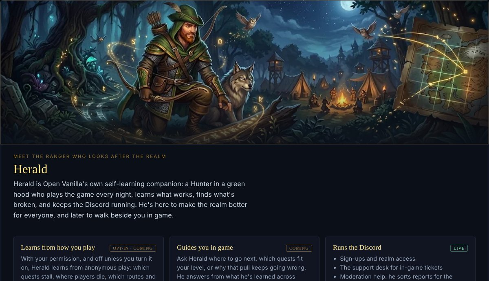
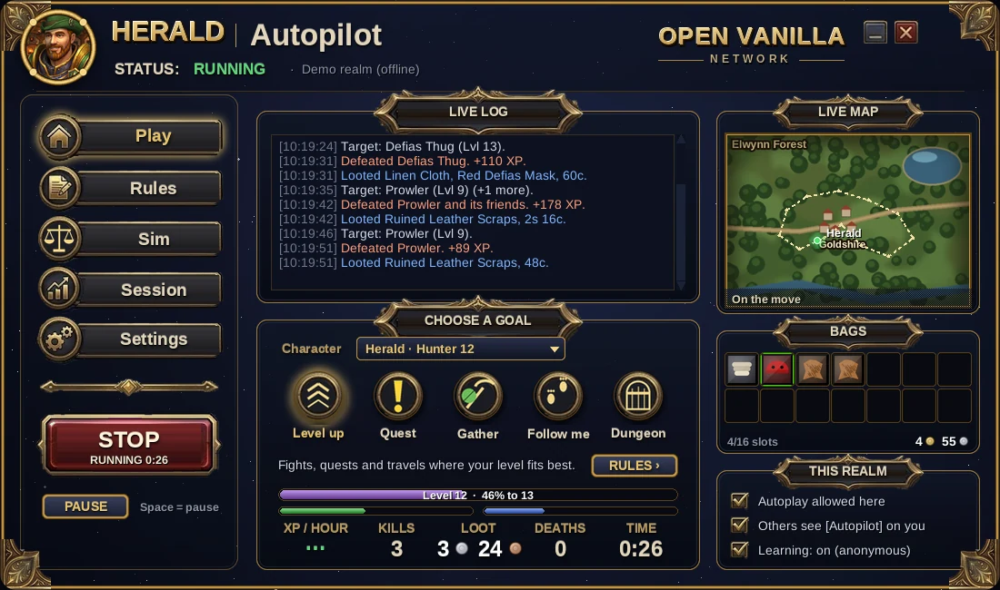
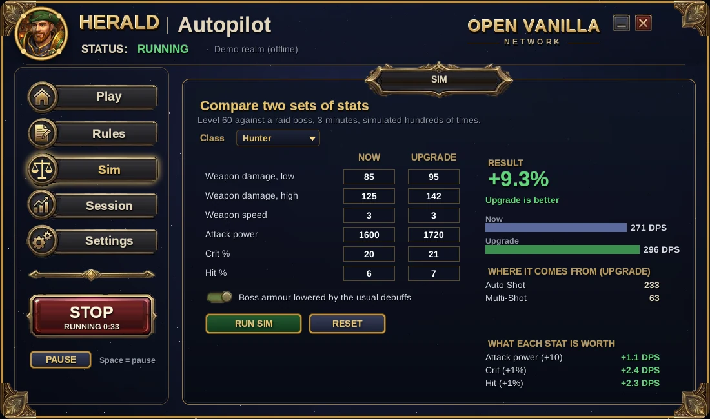

# Herald

**Open Vanilla's own companion: a Hunter in a green hood who runs the Discord, tests every release, and can play your character for you.**



## The pieces

- **Discord bot** (`bot/herald.py`): the gate question and roles, Arrivals, the live server status, the moderation desk for in-game reports, live-stream alerts.
- **World chat bridge** (`bot/herald_bridge.py`): Discord and the in-game World channel, both ways ([docs/DISCORD_BRIDGE.md](docs/DISCORD_BRIDGE.md)).
- **Herald Autopilot** (`autopilot/`, `Herald Autopilot.bat`): pick a goal and press START, set rules in plain sentences ("Rest when health is below 35%"), compare two sets of gear in a 1.12 damage simulator, and watch the live log, map and bags.
- **In game**: click **Herald** by the minimap (or `/herald`) and press **Let Herald play**. Your character plays on the realm's own bot AI; **Take back control** any time.
- **Planner and simulator** (`tools/autopilot`): routes and kite tactics from the game data, minutes-per-level predictions.

| | |
|---|---|
|  |  |

## Honest by design

Herald plays only where the realm allows it, on his own bot account, never in PvP or the economy, and nothing in Autopilot hides from a realm's staff: no anti-ban features, no fake human delays. Learning is opt-in and sends anonymous numbers only, never names, chat, positions or accounts. What runs today and what's still coming: [docs/HERALD.md](docs/HERALD.md).

## Run it

```
python autopilot/herald_autopilot.py --demo     # Herald Autopilot with the offline demo realm (Python 3.10+, Pillow)
bot\Start_Herald.bat                            # the Discord bot on your PC (installs discord.py and pymysql once)
```

Settings for the bot: `bot/root/.env.example`. For 24/7 the bot runs on the realm server; its install is `hetzner/herald_up.sh` in [openvanilla-server](https://github.com/orionopenwow/openvanilla-server).

## Part of Open Vanilla

[Open Vanilla](https://github.com/orionopenwow/OpenVanilla) is a free, open-source, community-built Vanilla project ([openvanilla.app](https://openvanilla.app/), [Discord](https://discord.gg/r6nj5p8U4)). Its products:

- [Vanilla Forge](https://github.com/orionopenwow/vanilla-forge): The Open Vanilla creator app: maps, models, creatures, quests, items and addons, tested in a copy of your game and published as a signed pack.
- [Vanilla Agents](https://github.com/orionopenwow/vanilla-agents): Your AI coding helpers as heroes in a cosy inn: you roam, they work, a checker verifies every quest.
- [Herald](https://github.com/orionopenwow/herald) (this one): The Open Vanilla Discord bot, the in-game World chat bridge, and Herald Autopilot: he plays a character for you, simulates gear and learns from play.
- [Open Vanilla Server](https://github.com/orionopenwow/openvanilla-server): Everything that runs a realm: the realm images and CMaNGOS patches, the web/asset service, Server Studio, Play Solo packs, the relay, and the turnkey Hetzner deployment.
- [Open Vanilla Launcher](https://github.com/orionopenwow/openvanilla-launcher): OpenVanilla.exe: play online, solo or in the browser, the Workshop, signed updates and live news; plus the release packaging.
- [Vanilla Remastered UI](https://github.com/orionopenwow/vanilla-remastered-ui): The in-game addon suite (WenillaCore, Quests, Transmog, Achievements, Guilds and the rest), Classic+ data, and the Workshop addon catalog.
- [openvanilla.app](https://github.com/orionopenwow/openvanilla-site): The Open Vanilla website (GitHub Pages) and the player manual.
- [Open Vanilla Devkit](https://github.com/orionopenwow/openvanilla-devkit): Test a change in seconds on your PC, try it against the live realm, and let a staging realm prove it first; plus the project's checks and tests.
- [Open Vanilla Agent Kit](https://github.com/orionopenwow/openvanilla-agent-kit): Let an AI coding agent change your copy of Open Vanilla for you: addons, interface, your own realm's rates and NPCs.
- [Open Vanilla Art & Tools](https://github.com/orionopenwow/openvanilla-art-tools): Art sources, UI kits and the generator scripts behind the launcher, site and addon artwork; plus the project's maintenance tools.

## License

MIT: see [LICENSE](LICENSE).

## About this repository

This repository is published from **Open Vanilla** (commit `3240065f8b`: Release 1.43.0). Changes are made there and arrive here with each release, so please open issues and pull requests on [Open Vanilla](https://github.com/orionopenwow/OpenVanilla/issues).

World of Warcraft is a trademark of Blizzard Entertainment, Inc. Open Vanilla is an independent fan project, not affiliated with or endorsed by Blizzard Entertainment. No Blizzard game files are included: you need your own.
